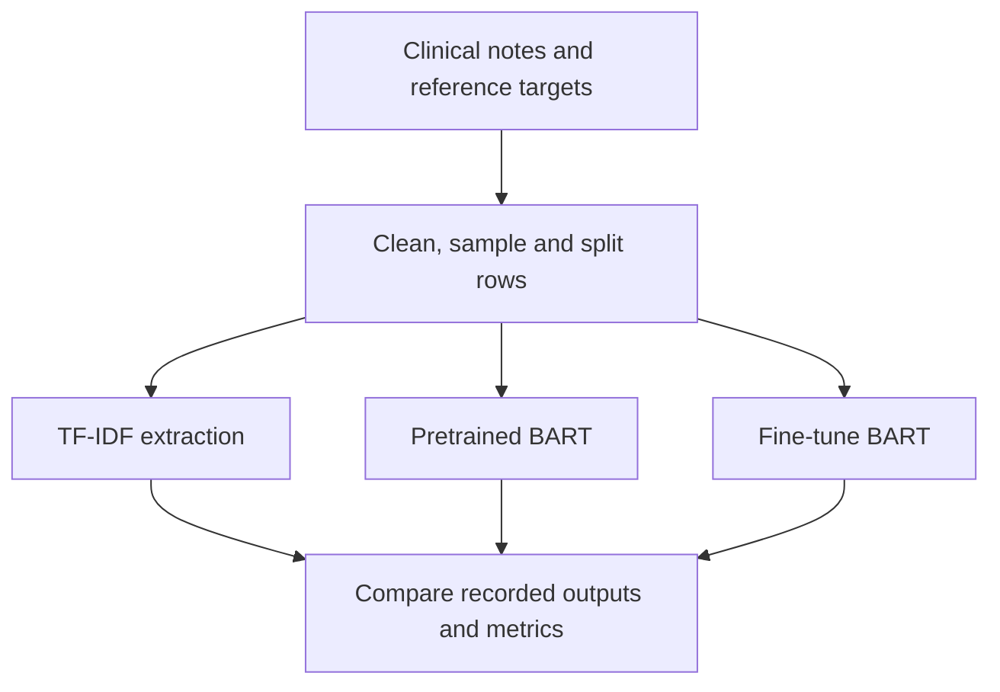
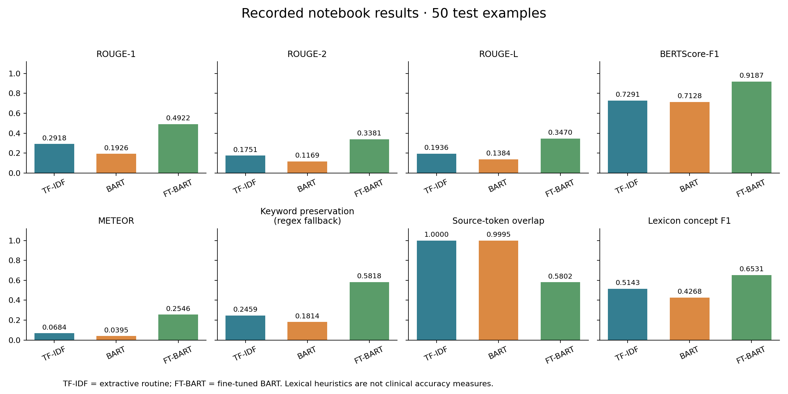

<div align="center">

# Medical Record Summarization

**TF-IDF extraction · BART fine-tuning · Multi-metric evaluation**

A Python notebook experiment comparing three approaches to clinical-note summarization and structured target generation.

Maintained by [viraj54](https://github.com/viraj54)

[Methods](docs/METHODS.md) · [Metric definitions](docs/METRICS.md) · [Recorded results](docs/RESULTS.md) · [Verification](docs/VERIFICATION.md)

</div>

## Overview

The project compares an extractive TF-IDF routine, pretrained `facebook/bart-large-cnn`, and the same BART checkpoint fine-tuned on clinical notes and their structured reference targets. It includes preprocessing, exploratory plots, supervised training, inference and evaluation in one notebook.

**Research demonstration:** generated summaries are not validated for clinical decisions. The project does not establish medical accuracy or a low hallucination rate.

## Workflow



## Experiment configuration

| Setting | Value |
|---|---|
| Dataset | `AGBonnet/augmented-clinical-notes` |
| Sample | 5,000 rows, seed 42 |
| Train / validation / test | 3,500 / 750 / 750 rows |
| Metric comparison | First 50 test rows |
| Training input / target limit | 512 / 384 tokens |
| Learning rate | 3e-5, cosine schedule |
| Training duration | Up to five epochs; early-stopping patience 2 |
| Per-device batch / accumulation | 2 / 4 |
| Fine-tuned decoding | Four beams; maximum 384 tokens |

The split is row-level; patient-level separation is not verified. The pretrained baseline uses a different input/decoding budget, so the comparison does not isolate fine-tuning alone. [Exact method details](docs/METHODS.md).

## Recorded results



| Metric | Extractive routine | Pretrained BART | Fine-tuned BART |
|---|---:|---:|---:|
| ROUGE-1 | 0.2918 | 0.1926 | 0.4922 |
| ROUGE-2 | 0.1751 | 0.1169 | 0.3381 |
| ROUGE-L | 0.1936 | 0.1384 | 0.3470 |
| BERTScore-F1 | 0.7291 | 0.7128 | 0.9187 |
| METEOR | 0.0684 | 0.0395 | 0.2546 |

These are supplied notebook results, not a newly trained run. Three additional heuristic scores are retained with accurate labels in [results](docs/RESULTS.md). In particular, “factual consistency” in the original notebook is source-token overlap; “MEDCON” is a custom lexicon score rather than UMLS concept linking. [Read what each metric measures](docs/METRICS.md).

## Run locally

Use a dedicated Python 3.11 environment from the repository root:

```sh
git clone https://github.com/viraj54/NLP-Medical-Record-Summarization.git
cd NLP-Medical-Record-Summarization
python -m venv .venv
```

Activate with `.venv\Scripts\activate` in Windows Command Prompt, or `source .venv/bin/activate` on macOS/Linux.

```sh
python -m pip install -r requirements.txt
python -m jupyterlab
```

Open `notebooks/medical_record_summarization.ipynb` and run cells in order. The notebook downloads its public dataset, BART checkpoint, BERTScore encoder and NLTK resources. A CUDA GPU is recommended for BART-large fine-tuning. Saved models, plots and newly calculated metrics go to `outputs/`, which is excluded from version control.

The dependency file retains the Transformers v4 API used by the experiment. The notebook does not automatically downgrade packages in an existing hosted environment. SciSpaCy is optional and is not installed by default; the recorded run used the regex keyword fallback.

No project-trained checkpoint is included. Run training before using the fine-tuned inference cells. JSON-style output is plain generated text and is not schema-validated. The project has no web interface.

## Lightweight checks

These tests need no model downloads, GPU or clinical dataset:

```sh
python -m pip install -r requirements-dev.txt
python -m unittest discover -s tests -v
python tools/check_notebook.py
```

## Repository contents

| Location | Contents |
|---|---|
| `notebooks/` | Output-cleared experiment notebook |
| `src/heuristics.py` | Inspectable extractive and lexical utility functions |
| `results/` | Recorded aggregate metrics and experiment metadata |
| `assets/` | Chart generated from the recorded metric table |
| `docs/` | Methods, results, metric definitions and verification |
| `tests/` | Synthetic utility/metric checks |
| `tools/` | Notebook integrity checks |

## Data and model references

- [AGBonnet/augmented-clinical-notes](https://huggingface.co/datasets/AGBonnet/augmented-clinical-notes).
- [facebook/bart-large-cnn](https://huggingface.co/facebook/bart-large-cnn), based on [BART](https://arxiv.org/abs/1910.13461).
- [BERTScore](https://github.com/Tiiiger/bert_score), [ROUGE](https://github.com/google-research/google-research/tree/master/rouge) and [NLTK METEOR](https://www.nltk.org/api/nltk.translate.meteor_score.html).

External models, datasets and libraries retain their own terms. The repository does not redistribute dataset records or model weights. Do not commit identifiable clinical notes or regenerated example outputs.

## License

Project-owned code and documentation permit noncommercial learning, research and demonstrations under [LICENSE.txt](LICENSE.txt). Commercial use requires written permission; external materials remain governed by their own terms.
